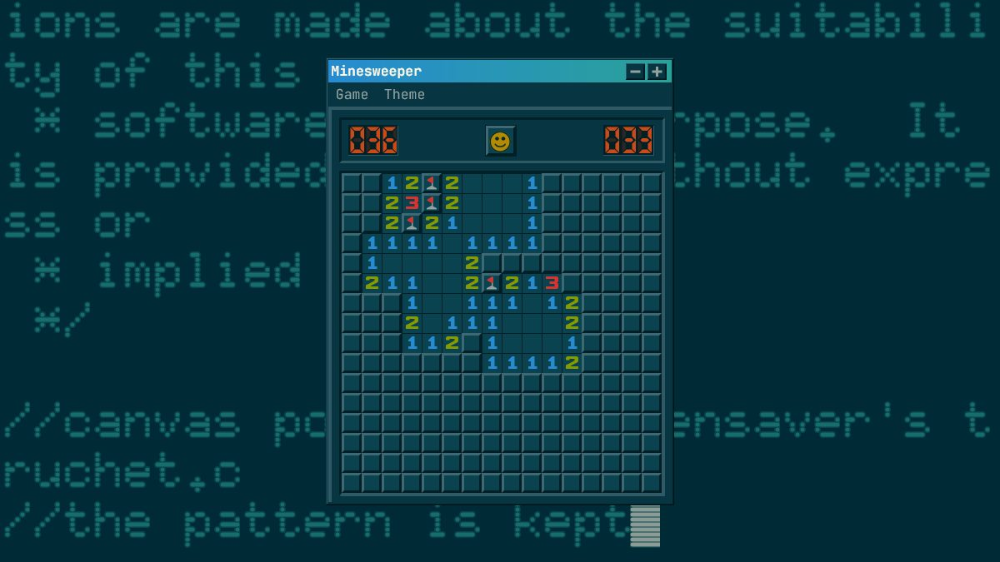

# Minesweeper

A Windows style minesweeper with classic, synthwave, solarized truchet, solarized phosphor, matrix and nord themes.

[Play Minesweeper](https://fexofenadine.github.io/minesweeper/)

[](https://fexofenadine.github.io/minesweeper/)

## Themes

Pick a theme from the **Theme** menu. Your choice is remembered.

| Synthwave (expert, game over)                        | Matrix                                               |
| ---------------------------------------------------- | ---------------------------------------------------- |
|          |                |
| **Solarized Truchet**                                | **Solarized Phosphor**                               |
|  |  |
| **Nord**                                             |                                                      |
|                    |                                                      |

## What this fork adds

On top of the [original game](https://github.com/frenzzy/minesweeper), which has the classic look, the four difficulty levels, marks, best times and touch support, this fork adds:

### Six themes

- **Classic** keeps the Windows look, with a freely licensed background colour matched to the Windows XP wallpaper and a Windows 95 pixel font for the menus and title bar. It can optionally show an animated Bliss-style scene instead (off by default): a green hill colour matched to Bliss under a live sky with drifting cumulus and cirrus clouds and their shadows.
- **Synthwave** uses the SynthWave '84 palette over a neon wireframe landscape, with VHS scanlines, film grain, a rolling tracking band and tape wobble, glitching counters, a pulsing neon window glow and Monoton and Audiowide fonts.
- **Solarized Truchet** uses the Solarized palette and JetBrains Mono over xscreensaver's Truchet, slowly panning across winding tiles of arcs and lines in a Solarized accent colour.
- **Solarized Phosphor** has the same colours over xscreensaver's Phosphor, a glass terminal with long-sustain phosphor that types out this game's own source code.
- **Matrix** is monochrome green on black over falling code rain ported from xscreensaver's GLMatrix, with glowing glyphs, CRT scanlines, glitching counters, a pulsing green haze around the window and Share Tech Mono.
- **Nord** uses the Nord Dark palette over xscreensaver's Substrate, which grows straight and curved cracks across the screen and shades the gaps between them with sand in Nord's frost and aurora colours.
- In Synthwave and Matrix, hitting a mine makes the minefield glitch out until the next game.

### Gameplay

- **Double-click chording**: double-click (or tap) a revealed number whose mines are all flagged to open every unflagged neighbour. If the flags don't match the number, the reason is shown under the board: too many flags are outlined in amber, and the cells where the missing flags belong in dashed violet.
- **Extreme level**: 39 × 21 with 169 mines, Expert grown by 30% each way at the same mine density. It has its own best time.
- **Safe First Click** (on by default): mines are only placed after the first click, never under it.
- **No Guessing**: the first click opens an empty area and every board can be solved with logic alone. A solver checks each board and redeals until it finds one, usually in a few milliseconds even on Expert.
- **Hint** (Game menu or `H`): highlights a move that follows with certainty and explains the reasoning under the board. Blue marks the numbers it reasons from, green cells are safe, red cells are mines and amber marks flags that contradict a number. It only uses the visible numbers and your flags, and says so when only a guess is left. The F2, N and H shortcuts are ignored while typing in a dialog or with Ctrl, Alt or Cmd held.
- **Best times** are kept in two tabs, one for games played without hints and one for games where a hint was used.

### Window and display

- **Zoom**: the − and + buttons in the title bar scale the whole window in steps from 50% to 400%, and double-clicking the title bar goes back to 100%. The zoom is remembered.
- **Fits the screen**: when a level, custom grid, theme or browser size would make the window too big, it shrinks to fit, but never below 62.5% (about 10 pixel cells), where the page scrolls instead. Zooming in past the fitted size is allowed and scrolls too. On small screens the margin around the window shrinks as well.
- **Portrait screens**: on a screen taller than it is wide, a board that is wider than tall (Expert, Extreme or a wide custom grid) is shown turned on its side, columns as rows, so it fills the screen instead of shrinking. Numbers stay upright, and it switches back when the screen turns to landscape.
- **Full-screen backgrounds**: wallpapers always cover the browser window, whatever its size, zoom or orientation.
- **Background settings** (Theme menu, for every theme except Synthwave): the animated xscreensaver backgrounds have the same options as the originals, such as density, speed, glyph set, fog and waves for GLMatrix, growth delay, crack counts, sand grains, circular cracks and wireframe for Substrate, tile and line sizes, curves, angles and scrolling for Truchet, and scale, fade and typing speed for Phosphor. Each can also be switched to a static background: the Solarized themes show their original code photo, Matrix a digital rain photo, Nord a finished still picture, and Classic, where animation is off by default, its usual photo. Changes preview live, Cancel puts them back and Defaults restores the original look. Settings for every background are saved together.

### Under the hood

- Rebuilt on [Vite](https://vite.dev) with Vitest, ESLint and Prettier, replacing the abandoned hyperapp-tools webpack 4 setup.
- A plain static build with readable asset names, versioned links so browsers never mix old and new files, and a simple offline-capable service worker.
- Google Analytics removed.
- Tests for chording, mine placement and the no-guessing solver.

## Development

```sh
yarn          #install dependencies
yarn start    #dev server
yarn build    #static site in build/
yarn test     #run tests
yarn lint     #lint
yarn deploy   #build and publish to github pages
```

## Credits

- Forked from [frenzzy/minesweeper](https://github.com/frenzzy/minesweeper) by Vladimir Kutepov, bootstrapped with [Hyperapp Starter](https://github.com/kriasoft/hyperapp-starter).
- Classic background by [Chris Barbalis](https://unsplash.com/photos/green-grass-field-under-blue-sky--nYBR0LFTvQ) on Unsplash, colour matched to resemble Bliss.
- Classic's animated hill is cut from [Clouds above Cattle Hill, Roedean](<https://commons.wikimedia.org/wiki/File:Clouds_above_Cattle_Hill,_Roedean_(February_2011).JPG>) by Hassocks5489 (CC0), retouched, mirrored and colour matched to Bliss by `src/backgrounds/hill.py`. Its sky and clouds are drawn live.
- Synthwave background by [Neeqolah Creative Works](https://unsplash.com/photos/a-computer-generated-image-of-a-sun-setting-in-the-distance-Tn5gnXGI3hI) on Unsplash.
- Synthwave colours from [SynthWave '84](https://github.com/robb0wen/synthwave-vscode) by Robb Owen.
- Solarized static background by [Chris Ried](https://unsplash.com/photos/ieic5Tq8YMk) on Unsplash.
- Solarized Truchet background is a canvas port of [Truchet](https://github.com/xscreensaver/xscreensaver/blob/master/hacks/truchet.c) from xscreensaver by Adrian Likins.
- Solarized Phosphor background is a canvas port of [Phosphor](https://github.com/xscreensaver/xscreensaver/blob/master/hacks/phosphor.c) from xscreensaver by Jamie Zawinski, with its built-in public domain 6x10 font.
- Matrix code rain is a canvas port of [GLMatrix](https://github.com/xscreensaver/xscreensaver/blob/master/hacks/glx/glmatrix.c) from xscreensaver by Jamie Zawinski.
- Matrix static background [Binary damage code](<https://commons.wikimedia.org/wiki/File:Binary_damage_code_(28227210988).jpg>) by Markus Spiske (CC0).
- Nord background is a canvas port of [Substrate](https://github.com/xscreensaver/xscreensaver/blob/master/hacks/substrate.c) from xscreensaver, by J. Tarbell ([complexification.net](http://complexification.net)) and Mike Kershaw.
- Nord colours from [Nord](https://www.nordtheme.com) by Arctic Ice Studio.
- Theme fonts [Monoton](https://fonts.google.com/specimen/Monoton) by Vernon Adams, [Audiowide](https://fonts.google.com/specimen/Audiowide) by Astigmatic, [Share Tech Mono](https://fonts.google.com/specimen/Share+Tech+Mono) by Carrois Type Design and [JetBrains Mono](https://www.jetbrains.com/lp/mono/) by JetBrains, all under the SIL Open Font License (licences in `src/fonts/`).
- Classic menu and title bar font is a pixel conversion of [Wine](https://gitlab.winehq.org/wine/wine)'s MS Sans Serif by Huw D M Davies and Dmitry Timoshkov, under the LGPL 2.1 (source, converter and licence in `src/fonts/`).
