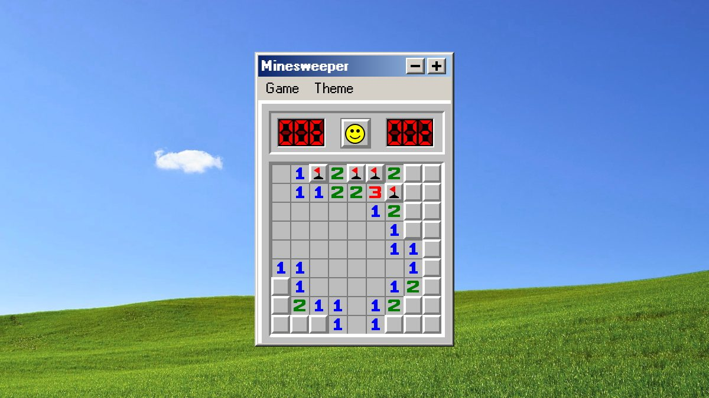
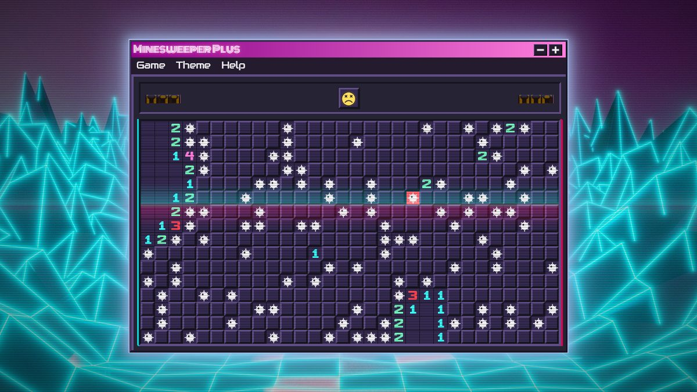
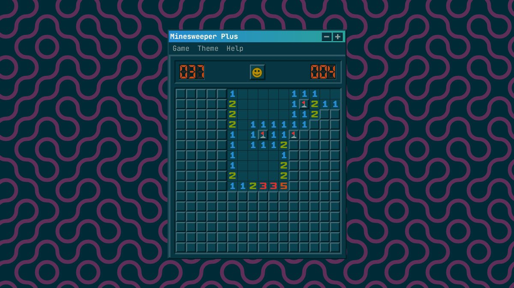
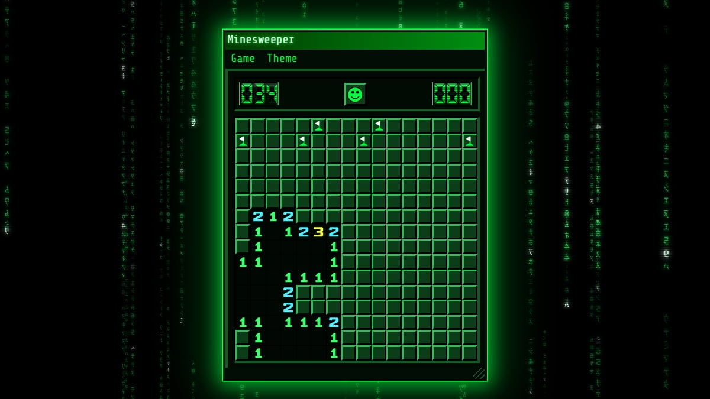
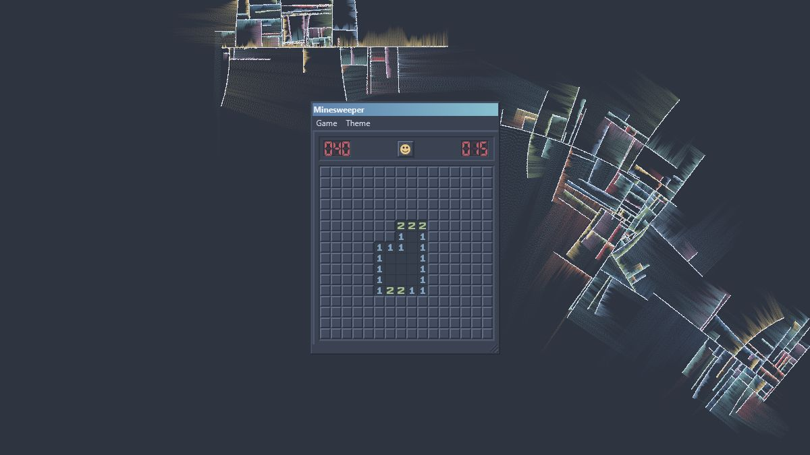

# Minesweeper

A Windows style minesweeper with classic, synthwave, solarized dark, matrix and nord themes.

[Play Minesweeper](https://fexofenadine.github.io/minesweeper/)

[](https://fexofenadine.github.io/minesweeper/)

## Themes

Pick a theme from the **Theme** menu. Your choice is remembered.

| Synthwave (expert, game over)                | Solarized Dark                                    |
| -------------------------------------------- | ------------------------------------------------- |
|  |  |
| **Matrix**                                   | **Nord**                                          |
|        |                 |

## What this fork adds

On top of the [original game](https://github.com/frenzzy/minesweeper), which has the classic look, the four difficulty levels, marks, best times and touch support, this fork adds:

### Five themes

- **Classic** keeps the Windows look, with a freely licensed background colour matched to the Windows XP wallpaper and a Windows 95 pixel font for the menus and title bar.
- **Synthwave** uses the SynthWave '84 palette over a neon wireframe landscape, with VHS scanlines, film grain, a rolling tracking band and tape wobble, glitching counters, a pulsing neon window glow and Monoton and Audiowide fonts.
- **Solarized Dark** uses the Solarized palette over a blurred code photo, with JetBrains Mono.
- **Matrix** is monochrome green on black over falling code rain ported from xscreensaver's GLMatrix, with glowing glyphs, CRT scanlines, glitching counters, a pulsing green haze around the window and Share Tech Mono.
- **Nord** uses the Nord Dark palette over xscreensaver's Substrate, which grows straight and curved cracks across the screen and shades the gaps between them with sand in Nord's frost and aurora colours.
- In Synthwave and Matrix, hitting a mine makes the minefield glitch out until the next game.

### Gameplay

- **Double-click chording**: double-click (or tap) a revealed number whose mines are all flagged to open every unflagged neighbour. If the flags don't match the number, the reason is shown under the board: too many flags are outlined in amber, and the cells where the missing flags belong in dashed violet.
- **Safe First Click** (on by default): mines are only placed after the first click, never under it.
- **No Guessing**: the first click opens an empty area and every board can be solved with logic alone. A solver checks each board and redeals until it finds one, usually in a few milliseconds even on Expert.
- **Hint** (Game menu or `H`): highlights a move that follows with certainty and explains the reasoning under the board. Blue marks the numbers it reasons from, green cells are safe, red cells are mines and amber marks flags that contradict a number. It only uses the visible numbers and your flags, and says so when only a guess is left. The F2, N and H shortcuts are ignored while typing in a dialog or with Ctrl, Alt or Cmd held.
- **Best times** are kept in two tabs, one for games played without hints and one for games where a hint was used.

### Window and display

- **Resizable window**: drag the grip in the bottom right corner to scale the whole window up or down, keeping its aspect ratio so the cells stay square. Double-click the grip to reset. The size is remembered.
- **Full-screen backgrounds**: wallpapers always cover the browser window, whatever its size, zoom or orientation.
- **Background settings** (Theme menu, Matrix and Nord): the animated xscreensaver backgrounds have the same options as the originals, such as density, speed, glyph set, fog and waves for GLMatrix, and growth delay, crack counts, sand grains, circular cracks and wireframe for Substrate. Changes preview live, Cancel puts them back and Defaults restores the original look. Settings for every background are saved together.

### Under the hood

- Rebuilt on [Vite](https://vite.dev) with Vitest, ESLint and Prettier, replacing the abandoned hyperapp-tools webpack 4 setup.
- A plain static build with readable asset names, versioned links so browsers never mix old and new files, and a simple offline-capable service worker.
- Google Analytics removed.
- Tests for chording, mine placement and the no-guessing solver.

## Development

```sh
yarn          #install dependencies
yarn start    #dev server
yarn build    #static site in build/
yarn test     #run tests
yarn lint     #lint
yarn deploy   #build and publish to github pages
```

## Credits

- Forked from [frenzzy/minesweeper](https://github.com/frenzzy/minesweeper) by Vladimir Kutepov, bootstrapped with [Hyperapp Starter](https://github.com/kriasoft/hyperapp-starter).
- Classic background by [Chris Barbalis](https://unsplash.com/photos/green-grass-field-under-blue-sky--nYBR0LFTvQ) on Unsplash, colour matched to resemble Bliss.
- Synthwave background by [Neeqolah Creative Works](https://unsplash.com/photos/a-computer-generated-image-of-a-sun-setting-in-the-distance-Tn5gnXGI3hI) on Unsplash.
- Synthwave colours from [SynthWave '84](https://github.com/robb0wen/synthwave-vscode) by Robb Owen.
- Solarized Dark background by [Chris Ried](https://unsplash.com/photos/ieic5Tq8YMk) on Unsplash.
- Matrix code rain is a canvas port of [GLMatrix](https://github.com/xscreensaver/xscreensaver/blob/master/hacks/glx/glmatrix.c) from xscreensaver by Jamie Zawinski.
- Nord background is a canvas port of [Substrate](https://github.com/xscreensaver/xscreensaver/blob/master/hacks/substrate.c) from xscreensaver, by J. Tarbell ([complexification.net](http://complexification.net)) and Mike Kershaw.
- Nord colours from [Nord](https://www.nordtheme.com) by Arctic Ice Studio.
- Theme fonts [Monoton](https://fonts.google.com/specimen/Monoton) by Vernon Adams, [Audiowide](https://fonts.google.com/specimen/Audiowide) by Astigmatic, [Share Tech Mono](https://fonts.google.com/specimen/Share+Tech+Mono) by Carrois Type Design and [JetBrains Mono](https://www.jetbrains.com/lp/mono/) by JetBrains, all under the SIL Open Font License (licences in `src/fonts/`).
- Classic menu and title bar font is a pixel conversion of [Wine](https://gitlab.winehq.org/wine/wine)'s MS Sans Serif by Huw D M Davies and Dmitry Timoshkov, under the LGPL 2.1 (source, converter and licence in `src/fonts/`).
